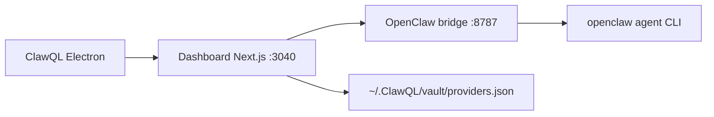

# ClawQL Desktop (macOS · Windows · Linux)

**Status:** Multi-platform Electron shell · **Package:** `apps/desktop/`  
**Supersedes:** macOS-only notes formerly in `clawql-desktop-macos.md` (same content, expanded targets).

ClawQL Desktop wraps the existing **dashboard** with local-first provider secrets and **Agent Chat** — the primary solo-dev differentiator vs browser-only or CLI-only flows.

## Architecture



| Layer       | Technology                                         |
| ----------- | -------------------------------------------------- |
| Shell       | Electron 35                                        |
| UI          | `apps/dashboard/` Next.js 16 (standalone bundle)   |
| Secrets     | `CLAWQL_DESKTOP_MODE=1` → `/api/local/providers`   |
| Chat        | `openclaw-chat-bridge.mjs` → `openclaw agent`      |
| Persistence | `CLAWQL_OBSIDIAN_VAULT_PATH` (default `~/.ClawQL`) |

## Platform artifacts

| OS      | Builder target    | Output                               |
| ------- | ----------------- | ------------------------------------ |
| macOS   | `dmg`             | `ClawQL-<version>.dmg`               |
| Windows | `nsis`            | `ClawQL-Setup-<version>.exe`         |
| Linux   | `AppImage`, `deb` | `ClawQL-<version>.AppImage` / `.deb` |

```bash
cd apps/desktop && npm install && npm run dist:mac    # or dist:win / dist:linux / dist:all
```

## Desktop vs Helm dashboard

| Capability       | Desktop                                   | K8s dashboard                |
| ---------------- | ----------------------------------------- | ---------------------------- |
| Provider secrets | Local JSON vault (MCP parity)             | Vault KV + `kubectl` sync    |
| Agent Chat       | Bundled bridge                            | Helm sidecar or external URL |
| Prerequisites    | Node bundled in app; **OpenClaw on PATH** | Cluster + Vault + ESO        |

## Security notes

- Renderer uses **context isolation** (no Node in the webview).
- Provider tokens live in **`~/.ClawQL/vault/providers.json`** mode `0600` — same as `clawql init`.
- Embedded dashboard binds **`127.0.0.1` only**.

## Signing / distribution

| Platform | Release bar                                              |
| -------- | -------------------------------------------------------- |
| macOS    | Developer ID + notarization before clawql.com download   |
| Windows  | Authenticode recommended (SmartScreen)                   |
| Linux    | Unsigned AppImage/deb acceptable for v0.1 site downloads |

## Roadmap

- Keychain / DPAPI / libsecret-backed secret storage
- First-run wizard aligned with `clawql onboard`
- Auto-update (electron-updater + signed feed)
- Bundle or bootstrap OpenClaw when missing

## Related

- [desktop/README.md](../../apps/desktop/README.md)
- [local-provider-vault.md](../getting-started/local-provider-vault.md)
- Mobile store app (approvals): [apps/mobile](../../apps/mobile/README.md)
